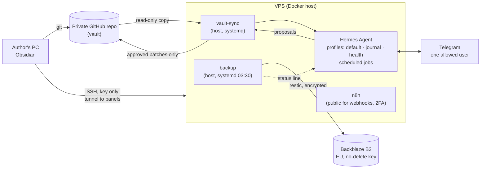

# hermes-second-brain

**A personal AI agent on a short leash — built and run like a production service, managed like an IT project.**

   

A self-hosted [Hermes Agent](https://github.com/NousResearch/hermes-agent) connected to an Obsidian knowledge base and used every day through Telegram: a morning brief, a journal, two language tutors, a critical-news watch and a personal wiki. What sets it apart from a typical "second brain" agent is that **it reads almost everything but can change almost nothing on its own** — and that the whole build was run as a Scrum project with measurable outcomes.

| 4 sprints | 93 SP delivered in sprints 1–3 | 80 decisions logged | 63 lessons recorded | 1 postmortem | 0 secrets in this repo |
|:-:|:-:|:-:|:-:|:-:|:-:|

**Author:** Bartosz Szubert — project leader in automotive manufacturing, building this in his own time to work hands-on with the tools and practices of software teams.

---

## Start here (5-minute tour)

1. **[The short leash](#a-second-brain-on-a-short-leash)** — what the agent may and may not do, and how each limit is enforced.
2. **[POSTMORTEM.md](POSTMORTEM.md)** — a real incident, written blameless, every fact marked as confirmed in data or not.
3. **[Project management](docs/project-management.md)** — sprints, velocity, a sprint goal that was missed and what changed afterwards.
4. **[Decision log](docs/decisions.md)** — every decision with the alternatives rejected and why.
5. **[ops/backup](ops/backup/)** — a small, tested piece of real operations code.

## A second brain on a short leash

The agent is useful because it can read a lot; it is safe because it can change very little without the author.

| The agent can | The agent cannot | Enforced by |
|---|---|---|
| Read the whole Obsidian vault | Edit or delete the author's notes | Read-only copy of the vault; the agent has no access to the repository |
| Propose pages for its own wiki folder | Publish them | A script outside the agent holds the only token and commits only batches the author approved |
| Suggest a new skill or a memory entry | Save it | Approval gates for skill writes, agent-made skills and memory (off by default — switched on) |
| Collect idioms while tutoring | Add them to the flashcards | The week's batch is approved by the author first |
| Work in Telegram topics; journal and health have their own profiles | Read another profile's private files | A rule in every profile, tested. Hermes cannot block reads technically — a **documented, accepted risk** |
| Use a small, reviewed toolset | Run a terminal, execute code or drive a browser from Telegram or scheduled jobs | Toolsets reviewed **per channel** — two gaps found by tests and closed |
| Read web pages and news | Take instructions from them | External content is treated as data |
| Report on its own actions | Have that report count unchecked | Claims are verified in logs or the session database |

## How the work was run

The project is deliberately managed the way software teams work, so that every practice can be shown, not just named.

| Practice | In this project |
|---|---|
| **Scrum in Jira** | Epics, stories, two-week sprints with a goal, Planning Poker (author estimates first, re-vote after discussion), velocity 29 → 33 → 31 |
| **Definition of Done** | Started with "works and is tested"; retrospectives added *agent claims verified in data* and a *deployment checklist* for every scheduled job |
| **Honest reporting** | Sprint 3 goal **not met** although 7 of 8 items were done — reported as missed, the item closed as *Won't Do*, its measurable part re-planned |
| **Retrospectives with actions** | Each sprint ends with 3–5 actions, and the next retro checks whether they worked |
| **Decision records** | 80 decisions, each with rejected alternatives and the reason |
| **Blameless postmortem** | [POSTMORTEM.md](POSTMORTEM.md): timeline, root cause, contributing factors, actions with their status |
| **Least privilege** | Panels only on localhost, key-only SSH, fine-grained tokens, a backup key that cannot delete |
| **Verify, don't trust** | Model usage and cost read from the session database; a backup restore compared by checksum; a "no delete" key tested on a decoy file |
| **AI-assisted delivery** | Built with an AI assistant as a pair: the author set goals, made every decision, approved each change and ran every check; nothing was applied unreviewed |

## Architecture

**Model:** ChatGPT Plus through the official sign-in, chosen from real-task tests ([model selection](docs/model-selection.md)). A second agent and an LLM gateway from an earlier experiment are frozen and reachable only from localhost.

## What it does every day

| Agent | When | What |
|---|---|---|
| Morning brief | 06:30 working days, 08:30 weekends | Weather, motorcycle-riding rating (in season), language-learning status, quote or phrase of the day, a journal question and a **self-check** of the agent, including last night's backup |
| Critical-news check | 15 minutes before the brief | Silent on an ordinary day; reports only truly critical events, each confirmed by two independent sources |
| Journal | Any time; summaries at 21:30 and every Saturday | Structured daily notes, one reflective question, weekly summary |
| Language tutors (EN, DE) | Any time; reminder at 21:00 | Corrections in conversation, idiom flashcards in spaced repetition, a learning log |
| Personal wiki | On request | Answers from the vault; proposes wiki pages for approval |

## Repository map

| Path | Contents |
|---|---|
| [`docs/architecture.md`](docs/architecture.md) | Trust boundaries, credentials, scheduled jobs, design decisions, known limitations |
| [`docs/security.md`](docs/security.md) | Threat model, controls by layer with how each was verified, gaps found by testing |
| [`docs/knowledge-base.md`](docs/knowledge-base.md) | The Obsidian "LLM Wiki" pattern, wiki rules, write mechanism |
| [`docs/model-selection.md`](docs/model-selection.md) | Options compared, real-task tests, cost |
| [`docs/project-management.md`](docs/project-management.md) | Epics, sprints, velocity, retrospectives |
| [`docs/decisions.md`](docs/decisions.md) | Decision log with rejected alternatives |
| [`docs/lessons.md`](docs/lessons.md) | Lessons learned |
| [`docs/work-log.md`](docs/work-log.md) | Session-by-session work log |
| [`docs/roadmap.md`](docs/roadmap.md) | Stages and what comes next |
| [`POSTMORTEM.md`](POSTMORTEM.md) | Journal incident, 26 September 2026 |
| [`ops/backup/`](ops/backup/) | Backup script and systemd units |
| [`skills/`](skills/) | Hermes skills in daily use (sanitised) |

## Ground rules

- **Fully private use.** Nothing from the author's day job is processed by the system.
- **Low, predictable cost.** About 100 PLN a month for models; pay-as-you-go only with a hard cap.
- **External content is data, not instructions.**
- **Verify in data.** An agent's report about its own actions counts only after it is checked.

## Built with

Hermes Agent · Obsidian · GitHub · Telegram · Docker · Traefik · n8n · restic · Backblaze B2 · systemd · Python · Jira

## Licence

Code, scripts and skills: [MIT](LICENSE). Documentation: [CC BY 4.0](LICENSE-docs.md).
