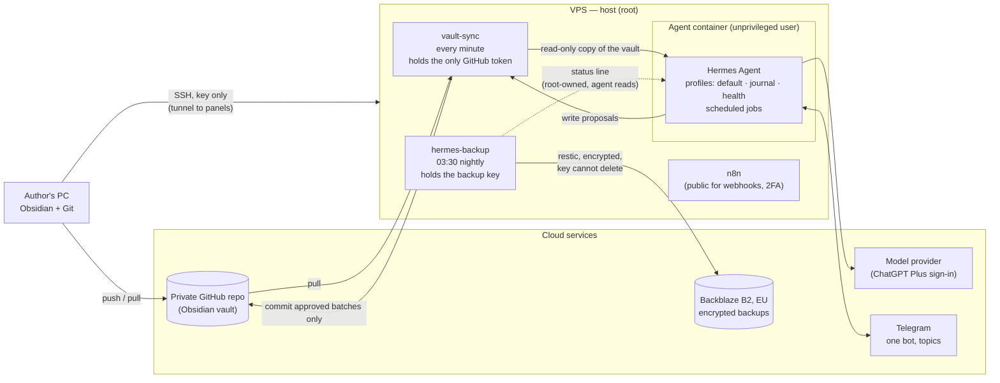

# Architecture

How the system is put together, where the trust boundaries are, which design decisions shaped it and what its known limits are. The history of how each part was built is in the [work log](work-log.md); every decision with its rejected alternatives is in the [decision log](decisions.md).

## Overview

The agent runs in a container as an unprivileged user. Everything that needs a powerful credential — writing to the vault repository, sending backups off the server — runs **on the host, outside the agent**, and talks to the agent only through folders it can read but not change. The author reaches the server only over key-based SSH; agent panels are bound to localhost and opened through an SSH tunnel.

## Components

| Component | Role | Notes |
|---|---|---|
| **Hermes Agent** | Personal agent platform: profiles, skills, scheduled jobs, Telegram gateway | Clean rebuild in October 2026; minimal toolset per channel; approval gates for skills and memory |
| **Obsidian + private GitHub repo** | Knowledge base ("second brain") | Edited on the PC; the Obsidian Git plugin syncs every few minutes |
| **vault-sync** (own Python script, systemd) | The only path from the agent to the vault repository | Keeps a read-only copy for the agent; commits only batches the author approved; writes its results to a state folder the agent can read. Details: [knowledge base](knowledge-base.md) |
| **hermes-backup** (own script, systemd) | Nightly off-site backup | restic to Backblaze B2; consistent SQLite copies; retention 7 daily / 4 weekly / 6 monthly. Code: [`ops/backup/`](../ops/backup/) |
| **Telegram** | The only user interface | One bot with topics; only the author's account may talk to it |
| **n8n + Traefik** | Workflow automation (older, separate agents) | Public because some workflows use webhooks; hardened with 2FA and pinned versions |
| **OpenClaw + OmniRoute** | A second agent and its LLM gateway from an earlier experiment | Frozen: localhost only, no new work |
| **VPS** | Single Docker host, about 4 GB RAM | A swap file was added after out-of-memory kills |
| **Jira** | Project management | See [project management](project-management.md) |

## Trust boundaries and credentials

Names and locations only — never values. A full inventory exists privately; it was built by listing variable and field names, not their contents.

| Credential | Lives in | Who can use it | Blast radius if leaked |
|---|---|---|---|
| Telegram bot token | Agent environment file | Agent | Someone could read messages sent to the bot and post as it; revoked through the bot's settings |
| Model sign-in (ChatGPT) | Agent's login file | Agent | Use of the author's ChatGPT plan; revoked by signing out the session |
| GitHub token — fine-grained, one repository, expiring | Host, root-only, outside the agent's data | vault-sync only | Read/write to the vault repository; the agent never sees it |
| Backup repository password and storage key | Host, root-only | hermes-backup only | Read backups; **cannot delete** them (key has no delete capability; hidden files are kept 30 days) |
| SSH key | Author's PC, with a passphrase | Author | Server access; password login is disabled |
| Panel logins, n8n encryption key | Host / n8n volume | Admin only | Panels are not reachable from the internet |

## Scheduled jobs (Europe/Warsaw)

| Time | Job | Runs as | Output |
|---|---|---|---|
| every minute | vault-sync | host | Vault copy refreshed; approved batches committed |
| 03:30 | hermes-backup | host | Encrypted snapshot to B2; status line |
| 06:15 weekdays · 08:15 weekends | Critical-news check | agent, default profile | Silent unless something critical is confirmed by two sources |
| 06:30 weekdays · 08:30 weekends | Morning brief | agent, default profile, lighter model | Brief with self-check |
| 21:00 daily | Tutor reminder | agent, default profile | A conversation starter, skipped on days with practice |
| 21:30 Sun–Fri · 22:00 Sat | Journal summary · weekly summary | agent, journal profile | Notes in the journal profile |
| weekly | Flashcard batch | agent, default profile | New idioms proposed for approval |

All agent jobs run with a scheduled-job toolset **without** terminal, code execution, browser, image generation, external connections or the ability to schedule further jobs. The container's time zone is set explicitly; data is stored with UTC timestamps.

## Key design decisions

| Decision | Why | What it costs |
|---|---|---|
| **One Telegram bot with topics**, not one bot per agent | One entry in the chat list; one token to protect | Routing topics to profiles had to be configured and tested |
| **Profiles by data sensitivity:** journal and health separate, learning material shared | Private conversations stay out of the shared agent's memory and search | No shared context; reads between profiles are blocked by a rule, not technically |
| **Vault writes only through a host-side script and approval** | An agent that can edit a knowledge base can also damage it, silently | Every new wiki page waits for the author |
| **Bundled skills disabled by default**; each one read and tested before enabling | Unused skills cost tokens in every conversation and invite failed attempts; 53 were on by default | A few useful skills that need a terminal stay off |
| **Powerful jobs on the host, not in the agent** (sync, backup) | The agent never holds the GitHub token or the backup key | Two small scripts to maintain outside the agent |
| **Model through the ChatGPT Plus sign-in** | Fixed monthly cost; model chosen from real-task tests | When the plan limit is hit, requests fail — there is no automatic fallback yet |

## Known limitations and accepted risks

- **Reads between profiles are not technically isolated.** Hermes can restrict where the agent writes, not what it reads. A rule in every profile forbids reading other profiles and was tested; full isolation options were compared and are in the backlog.
- **Single server.** The VPS is a single point of failure. Nightly off-site backups exist and a single-file restore was tested; a **full restore to a new server has not been rehearsed yet**.
- **No model fallback.** If the plan limit is reached, the agent stops answering until the window resets.
- **The status file is protected by ownership, not by a read-only mount.** It is root-owned and the agent cannot change it; a read-only mount is planned with the script-based self-check.
- **"No brief" is the alert.** If the agent itself is down, the signal is a missing morning brief; there is no independent uptime check yet.
- **The agent's reports about itself are unreliable.** It has misquoted sessions and reported failed jobs as done; such claims are always checked in logs or the session database.

## Evolution

| September 2026 | November 2026 |
|---|---|
| Hermes from a hosting template, free model endpoint, full default toolset | Clean rebuild; model chosen from real-task tests; toolsets reviewed per channel |
| Two agents in parallel | Hermes only; the second agent frozen |
| Journal in the default profile | Journal and health in their own profiles, routed by topic |
| Agent could be pointed at the vault directly | Read-only copy; writes only through approved batches |
| No backups, no health checks | Nightly off-site backup; self-check in the morning brief, including the backup |

A capped pay-as-you-go model reserve was planned in October but never set up; the secrets inventory in November found its only key unused, and the key was deleted.

<strong>How some parts were built (notes)</strong>

**Telegram topics and profiles.** Topics in a private bot chat are switched on in the bot's settings (Threaded Mode). Topic ids were read from the agent's session database rather than guessed. The journal and health profiles were created as **clones** of the default profile, so they inherited the reviewed toolset and approval gates — a profile created blank would have started with the full default toolset. Routing (`gateway.multiplex_profiles`, `gateway.profile_routes`) was written by a small script that refused to run on unexpected file contents and validated the YAML before saving. Tests: a control word written in one topic could not be found from the other profiles, in both directions.

**Skills review.** All 53 bundled skills were found enabled in every profile. They were all disabled, then re-enabled one by one after reading: several needed a terminal or wrote straight into the vault, contradicting the approval path. A 34 KB writing-style skill was replaced by one line in each profile's persona. Custom skills (`language-tutor`, `vault-wiki`, `morning-brief`, `critical-news`) were written through the approval gate and verified on the server by checksum; skill descriptions must fit 60 characters or the index truncates them. The agent's own background review once proposed four skills on its own — the approval gate held all four; two were rejected and two became the draft of `vault-wiki`.

**Findings worth keeping.** A scheduled task told to delete itself after running removed its own record mid-run, and the scheduler then discarded its result. Toolsets are configured per channel: a review of the command-line channel had left Telegram and scheduled jobs with the full default set — both gaps were found by tests and closed.

