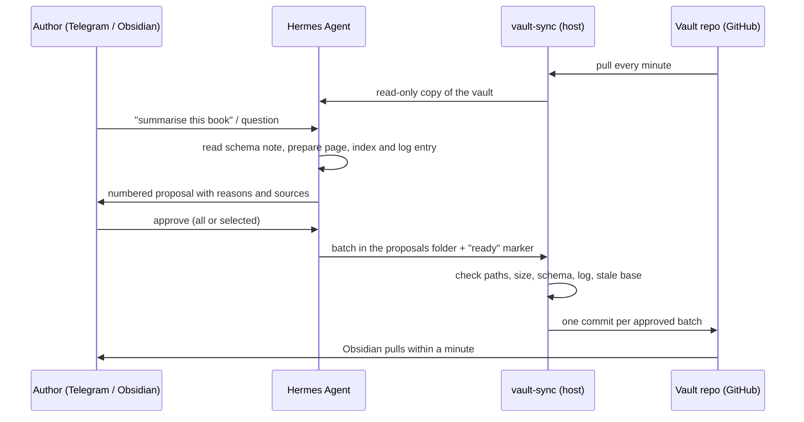

# Knowledge base (Obsidian, "LLM Wiki" pattern)

The agent's long-term knowledge is the author's Obsidian vault, organised after Andrej Karpathy's *LLM Wiki* idea: **raw sources → a wiki maintained by the LLM → a schema note with the rules**, kept up to date with three operations — *ingest*, *query* and *lint*.

This project adds one thing the original pattern does not have: **nothing the agent writes reaches the vault without the author's approval, and the agent cannot change the author's own notes at all.** The original pattern assumes a person supervising a local session; here the agent runs unattended on a server, is reached over Telegram and reads outside content every day.

## In one picture



## A real proposal

A weekly batch from the English tutor, as it arrived on Telegram in November 2026 (Polish, shortened: personal learning details replaced with "(…)").

```text
Paczka 008

Kontrola fiszek: wszystkie 9 kart z `cards.md` znajdują się już w `EN - fiszki - 2026-W44.md`.
Nie proponuję pustego pliku `EN - fiszki - 2026-W46.md`.

1. `EN - podsumowanie - 2026-W46.md` — dodanie
Podsumowanie okresu 2026-11-02–2026-11-15: mocne strony, słabe strony, wyniki powtórek idiomów, działające metody. (…)
Źródła:
- `/opt/data/agent-data/tutor-en/log.md`
- `EN - podsumowanie - 2026-W44.md`
- `EN - poziom.md`

2. `EN - poziom.md` — zmiana
Poziom bez zmian; profil uzupełniony o obserwacje do 2026-11-15. (…)
Źródła: (…)

Aktualizacja `index.md`:
- [[EN - podsumowanie - 2026-W46]] – Podsumowanie postępów, trudności i metod nauki języka angielskiego do tygodnia 2026-W46.

Fragment do `log.md`:
## 2026-11-15 | dodanie | EN - podsumowanie - 2026-W46
## 2026-11-15 | zmiana | EN - poziom

Bez usunięć.

Odpowiedź zatwierdzająca: `tak`
```

What it shows:

- **"Batch 008"** — numbered, so an approval always refers to one exact set of changes.
- **The agent checked before proposing**: all nine flashcards were already saved, so it did *not* propose an empty flashcard file.
- **Each change is typed** (*dodanie* = add, *zmiana* = change) and **lists its sources** — the tutor's learning log and earlier wiki pages.
- **Index and change-log entries are part of the proposal**, so the wiki's bookkeeping is approved together with the content.
- **"Bez usunięć"** (no deletions) is stated explicitly; deletions would appear in a separate section.
- **One word approves it** (`tak` = yes); only then does the agent write the batch for the script to commit.

## The original pattern and this project

| | Original LLM Wiki pattern | This project |
|---|---|---|
| **Who writes the wiki** | The LLM "owns this layer entirely" | The LLM drafts; the author approves every batch |
| **Raw sources** | "Immutable" — by rule | Read-only — enforced by the file system and by a script outside the agent |
| **Approval** | None formal ("possibly with humans in the loop" in a team example) | Required: a numbered proposal on Telegram, approved in full or in part |
| **Where the agent runs** | A local session the author supervises | Unattended on a server, reading web content daily |
| **History** | Git for "version history, branching, and collaboration for free" | Git for history *and* the agent never holds the token that writes it |

Approval is the real protection: history makes a bad change reversible, but reverting is manual work and a silent change may go unnoticed.

## Write mechanism — a decision worth showing

The agent has no terminal, so it needs *some* way to save pages. Facts that shaped the choice:

- A fine-grained GitHub token covers a whole repository; it cannot be limited to one folder.
- Protected branches (which block force pushes) need a paid plan for private repositories; on the free plan a write token could technically rewrite history.
- GitHub does not notify you about pull requests you opened yourself, and a fine-grained token acts as you.

| Option | Agent gets | What stops a write to the author's notes | Estimate |
|---|---|---|---|
| Rule only (closest to the original) | A GitHub tool with a write token | Rules in the schema note; a weekly look at the agent's commits | ≈3 SP |
| **Middle** | A read-only copy plus one proposals folder; a script outside the agent checks paths and commits | The script refuses anything outside the wiki folder | ≈5 SP |
| Full block | As middle, but the script opens a pull request and the author's merge is the final approval | The script, plus nothing lands without a merge | ≈8 SP |

The full block was chosen first, then questioned as too heavy for a personal knowledge base. A second opinion (another AI tool, given a neutral description of all three) ruled out the rule-only option but did not separate the other two. The deciding observation: the middle option and the full block cost almost the same to **build** — the full block only adds a pull request at the end of the same script — but differ in daily **use**: approve once on Telegram, or discuss on Telegram and then merge on GitHub every time.

**Decision: the middle option with a mode switch.** The script has a `commit` mode (on) and a `pull request` mode (off). If the agent ever writes something without approval — visible in the change log — pull requests are switched on without rebuilding anything.

**As implemented:**

- **Paths:** the vault copy is mounted into the agent read-only; the proposals folder sits inside the agent's data folder (its file tool refuses to write anywhere else); the script's state — base commit, results, archive — lives outside the agent and is mounted read-only, so the agent cannot alter a result.
- **Batch format:** one folder per batch with a description (summary, base commit, the author's exact approval and time), full new versions of the pages, an optional deletion list, and an empty "ready" marker written last so a half-written batch is never picked up.
- **Checks:** paths outside the wiki folder (including `..` and symlinks), the schema note, non-Markdown files, files over 200 KB, more than 20 files, a change log whose old entries changed or that gained no entry, deletion of the fixed files, and a stale base (a target file changed since the agent's base commit, for example by the author). Network errors are retried up to five times.
- **Run:** a systemd timer every minute; the agent sees new notes within about a minute of the author's commit.
- **Tests passed:** the agent's write to its copy failed; an approved batch (page, index and log) landed as one commit and reached the editor; a deletion batch removed the test page; two hand-made bad batches (a change to one of the author's notes, a change to the schema) were rejected with the repository unchanged; pull-request mode opened a pull request once, which was closed unmerged.
- **Delivery lesson:** a long script pasted into a terminal is fragile — one transcription error broke a compressed version; the file was copied with `scp` and verified by checksum against the tested version.

## Wiki rules

A dedicated wiki folder holds three fixed files: a **schema note** with the rules (only the author edits it; the agent reads it before every wiki operation), an **index** and an **append-only change log**.

| Rule | Why |
|---|---|
| Everything the agent creates goes into its wiki folder — pages flat in the folder, notes on request (books, films, articles) in one subfolder, per-agent subfolders (e.g. the tutor's flashcards) only with the author's consent | One place to review; the author's areas stay untouched |
| Every page has a type, a one-sentence description, created/changed dates, and *Related* and *Sources* sections | Pages stay findable and every claim traceable |
| No guessing: unsourced facts are marked unconfirmed; web facts carry an address and a verification date | A knowledge base is only as good as its weakest claim |
| Personal details the agent cannot know (a book's rating, the reading date) are asked, never filled in | The most convincing errors are invented details |
| Person pages hold relationship and collaboration context only — no sensitive data, no contact details | Notes about other people are not the agent's to collect |
| No secrets or confidential personal data, above all health and personal finance | The vault is synced off the server and read by a model provider |
| The author's edits to wiki pages win; the agent does not revert them | The human stays in charge of the content |
| Merging pages is preferred to deleting them; deletions are approved separately | Deletion is the change most likely to lose something |

Operations: **query** looks in the wiki first, then the rest of the vault, cites what it used and may offer to save a valuable answer; **ingest** and **lint** (contradictions, stale information, orphan pages, broken links, index consistency) run on request.

Open: rules for health data, and deleting pages in subfolders (the script deletes only at the top level of the wiki folder).

## Vault structure (top level)

| Folder | Purpose |
|---|---|
| `Studia` (studies) | Lecture notes per course, semester schedule, note-taking rules |
| *(AI learning folder)* | Notes on AI tools and patterns, e.g. the LLM Wiki pattern and Obsidian itself |
| `Infrastruktura` (infrastructure) | Runbooks and decisions for this project, sprint retrospectives, the agent's working rules |
| `Języki` (languages) | English and German learning material |
| `Książki` (books) | Read and to-read lists with ratings |
| `Pomysły`, `Dom`, `Motoryzacja` (ideas, home, vehicles) | Ideas and personal areas |
| `Szablony` (templates) | Note templates with YAML properties, so notes can be queried by agents |
| *(private areas)* | Excluded from this document |

The vault lives in git on the author's PC and in a private GitHub repository. It was moved there from a cloud-synced folder after that sync produced conflicting duplicates; the Obsidian Git plugin commits and pushes every five minutes.

<details>
<summary><strong>Book-note format (example of a detailed rule)</strong></summary>

Book notes follow the author's own conventions: file name `Surname Name - Title`; properties `typ`, `autor` (`Surname Name`), `status`, `ocena` (1–10), `data_przeczytania` (full date, or year and month when the day is unknown — the agent never invents a day), `gatunek`, `temat`, plus the agent's `przygotował`, `opis`, `utworzono`, `zmieniono`. Status, rating and date are always asked for. The full text of the note is shown in the proposal before anything is saved.

</details>
