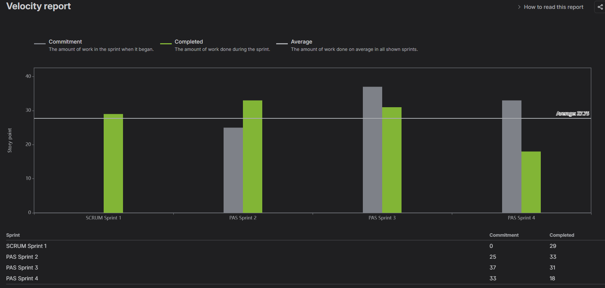
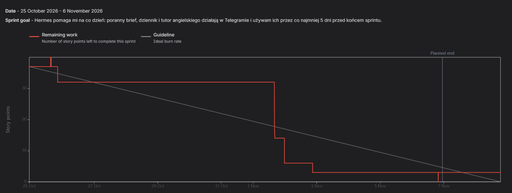
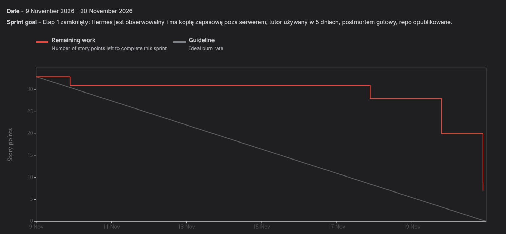

# Project management

The build was run as a Scrum project in Jira (free plan) for four sprints, then moved to Kanban — see [from Scrum to Kanban](#from-scrum-to-kanban). The point is not ceremony for its own sake: every practice below produced a decision, a correction or a number that is visible in this repository.

| Role | Who | Responsibilities |
|---|---|---|
| Product Owner and developer | The author | Goals, priorities, every decision and approval, estimates (first vote), all changes on the server, every check |
| Scrum Master (Kanban: flow keeper) and drafting partner | AI assistant | Facilitates planning, reviews and retrospectives; drafts specs, Definitions of Done and documents; challenges estimates and scope; never applies a change on its own |

## Sprints at a glance

| Sprint | Dates | Goal | Committed | Completed | Completed ÷ committed | Goal met? |
|---|---|---|---|---|---|---|
| 1 | 28 Sep – 9 Oct 2026 | A secure server and a knowledge base ready for the start of studies | 20¹ | **29** | 145% | Yes |
| 2 | 12 – 23 Oct | The agent runs on a clean install with a chosen model and reads the knowledge base from a private repository; SSH secured | 25 | **33** | 132% | Yes |
| 3 | 25 Oct – 6 Nov | Brief, journal and English tutor work in Telegram and are used on at least 5 days | 37 | **31** | 84% | **No** — see below |
| 4 | 9 – 20 Nov | Stage 1 closed: backup, postmortem, publication, tutor used on 5 days | 33 | **18** | 55%² | **Partly** — not published |

¹ Jira shows 0 for Sprint 1, because the sprint was started before its items were estimated — one of the first lessons ("start a sprint only after estimation").

² 78% of the 23 SP left after the scope checkpoint moved an 8-point item out (with the 2-point reserve untouched).

**Calibration.** The first two sprints were under-committed (work was added mid-sprint), the third over-committed. From Sprint 4 the commitment is sized from the average velocity (31) instead of from optimism, and stretch items are estimated so that real load shows in the numbers. Sprint 4 still missed: publication was estimated at 5 SP and turned out to be worth 8–13 (re-estimated at 13 and split in two), and unplanned work entered without an estimate.

## How the work is run

| Practice | How it is done here |
|---|---|
| **Backlog** | Epics by area; one-sentence ideas go to the backlog, never straight into a sprint; the whole backlog is exported and reviewed before planning |
| **Requirements first** | Since Sprint 3 every new-agent item starts with a short spec in Jira — job, user, data and its sensitivity, sources, what a good result looks like — before any setup |
| **Planning Poker** | The author estimates first, the assistant second; a difference is discussed and re-voted. Both directions happen: an item went 5 → 8 after listing its time-based behaviours; another 3 → 5 because "points measure effort, and five evenings of monotonous practice is real effort" |
| **Sprint goal** | One sentence that a review can test; stretch items are estimated and labelled outside the core |
| **Definition of Done** | A shared base plus item-specific criteria; it grows from retrospectives (below) |
| **Scope changes** | Since Sprint 4: only as a swap for an item of similar size, decided at a checkpoint, recorded in Jira |
| **Review** | Checked in data, not from memory: logs, the session database, files — and a goal is reported as missed when it is |
| **Retrospective** | Went well / went badly / 3–5 actions; the next retrospective checks whether each action worked |
| **Hygiene** | Abandoned items close as *Won't Do* (a status added to the workflow), not *Done*; dependencies as *is blocked by* links; spikes for research questions |

### How the Definition of Done grew

| Added after | Criterion |
|---|---|
| Sprint 1 | Works in practice and was tested (e.g. from another network or a fresh window); a note in the knowledge base if the system changed; a Jira comment with the result; no passwords, keys or server addresses in notes |
| Sprint 2 | The agent's reports about its own actions (done, quoted, saved) are verified in logs or data |
| Sprint 3 | Every item ends in a result that is *done*, not a habit; for every agent or scheduled job a deployment checklist: toolset of that channel, time zone, profile isolation, what is logged where, tool calls of the first run in the session database |

## The sprint that failed — and what changed

Sprint 3 finished **seven of eight items, both estimated stretch items included, and still missed its goal.** The goal asked for five days of real use of each agent; the brief, the critical-news check and the journal passed, the English tutor had conversations on three days.

- **Reported as missed**, not rounded up. The week-of-use item did not meet its Definition of Done.
- **Closed as *Won't Do*** (a status created for it) with a link to its replacement, instead of being marked *Done* with an exception.
- **Root cause in the retrospective:** the item was a habit, not a piece of work, and it entered *In Progress* only in the last days.
- **Actions:** plan from velocity (~30 SP); every item must end in a result that is *done*; the tutor part re-planned as a measurable action — reply to the evening reminder on five days, checked in the learning log; mid-sprint scope only as a swap.

*Sprint 3 burndown. Everything burns down by 3 November except the 3-point week-of-use item, which stays open past the planned end. The short spikes on the first day are an item added mid-sprint with its estimate.*

- **In Sprint 4** these actions were applied: a scope checkpoint on Thursday moved one 8-point item out of the sprint when four evenings remained for about 21 points, and the decision was recorded rather than left to show up as "not completed".

## From Scrum to Kanban

After Sprint 4 the project moved to Kanban (21 Nov). Scrum had served its purpose — four sprints of practice with goals, estimates, reviews and retrospectives, and a measured velocity — while a fixed sprint deadline fitted irregular evening work less well: the last two sprint goals were both missed, each on work that needed elapsed time (days of use, a fresh look the next day) rather than effort.

| Column | WIP limit | Meaning |
|---|---|---|
| Idea | — | A raw idea; lives in the backlog, empty on the board |
| To Do | 3 | Selected for work: description, Definition of Done and estimate ready |
| In Progress | 2 | Active work — one item worked on, one waiting (for a night of running, for example) |
| In Review | 2 | Waiting for a time-dependent check: a fresh look the next day, several nights, several days of use |
| Won't Do | — | Abandoned, with a comment and a link |
| Done | — | The last column: Jira reports count only the last column as completed |

| Kept from Scrum | Changed |
|---|---|
| Definition of Done, Planning Poker (author first), retrospectives with actions, scope only through Jira | Sprints → a continuous flow with WIP limits |
| Story points as a size measure | Velocity → throughput per two weeks and cycle time (cumulative flow diagram) |
| — | Planning → weekly replenishment of *To Do* (Sundays); review and retrospective every second Friday |

The switch exposed one more lesson: the *Won't Do* column, added on the right of *Done* on 8 Nov, had silently reset "completed" to zero for every past sprint in the velocity report. Moving *Done* back to the last column restored the numbers. The sprint reports were saved as screenshots before sprints were turned off.

## Epics

| Epic | Focus |
|---|---|
| Infrastructure and security | Server security, backups, updates, monitoring |
| Models and routing | Model choice, fallbacks, keys and caps |
| Hermes rebuild | Clean install, new journal, Telegram topics, shared "state of the day" |
| Knowledge base | Obsidian vault, templates, private repository, ingestion |
| Learning agents | Study tutor, language trainer (EN/DE), certification tutor |
| Monitoring agents | Morning brief, critical news, listings monitors |
| Personal assistant | Health coach, meal planning, trips, birthdays, books |
| Integrations | App integrations |
| Publication | This repository, the incident postmortem |
| *(private-stage epic)* | Excluded from the public stage |

## Sprint details

<strong>Sprint 1 — secure server and knowledge base (29 SP)</strong>

| Item | SP | Result |
|---|---|---|
| Audit of open server ports | 5 | Done |
| SSH key login from the PC | 5 | Done |
| Close public access to agent panels (blocked by the SSH item) | 8 | Done |
| 2FA in n8n | 1 | Done |
| Update n8n to a current, pinned version | 3 | Done |
| Install Obsidian and create the vault | 2 | Done |
| Lecture-note template | 3 | Done |
| Trial note | 2 | Done |

Three items (9 SP) were added during the sprint after the port audit changed the plan — each estimated before it entered. Retrospective: the initial buffer was too large; a port audit alone missed a second route through the reverse proxy, so security items now also check configuration files and proxy routes.

<strong>Sprint 2 — clean install, model, private repository (33 SP)</strong>

| Item | SP | Result |
|---|---|---|
| Analyse and choose a model | 8 | Real-task tests, usage measured from the session database, cost estimate — [model selection](model-selection.md) |
| Back up the old journal's persona and configuration | 3 | Verified backups kept |
| Private GitHub repository for the vault | 3 | Vault moved out of a cloud-synced folder, automatic sync tested |
| SSH hardening | 3 | Password login off, fail2ban confirmed against a real attacker |
| Clean Hermes installation | 5 | Wiped from the inside; panel on localhost; time zone set; minimal toolset; approval gates on |
| Wiki rules (added mid-sprint, blocks the next item) | — | Schema note, index and change log |
| Agent access to the vault with approved writes | 5 (3 → 8 → 5) | Host-side write path — [knowledge base](knowledge-base.md) |
| Telegram topics and profiles *(stretch, unestimated)* | — | Topics, journal and health profiles, routing tested both ways |
| Skills: select, read, install *(stretch, unestimated)* | — | Disabled-by-default policy; each enabled skill read and tested |

Retrospective: estimates changed mid-sprint (3 → 8 → 5), at first by the assistant rather than together; stretch items entered unestimated, so real load was invisible in velocity; architecture came before requirements. Actions: requirements first; estimate stretch items too and start a sprint only after estimation; ideas to the backlog; one step per message from the assistant; verify the agent's claims in data.

<strong>Sprint 3 — agents in daily use (31 SP, goal missed)</strong>

Each agent got a short spec, discussed question by question, before setup:

| Item | SP | Spec highlights |
|---|---|---|
| Morning brief | 5 | Scheduled job on the light model; sections only when they have content; interim self-check; weather with a per-day location override; seasonal motorcycle verdicts; language status; a journal question; a quote or phrase with a confirmed author |
| Journal | 5 | Built on the old journal persona: short acknowledgements, evening and weekly summaries, a work boundary, a "not therapy" clause; notes kept on the server in the journal profile |
| Language-tutor skill | 5 | Conversation first, corrections in a separate block, idiom flashcards with spaced repetition, a diagnostic test, material from the author's world |
| English tutor, first version | 8 (5 → 8) | Evening reminder on days without practice, learning log, weekly flashcard batch for approval |
| Week of use | 3 | Five days of real use confirmed in data — **not met** |
| Critical-news check *(stretch)* | 3 | Silent unless a narrowly defined critical event is confirmed by two sources |
| Vault skill *(stretch, added mid-sprint)* | 3 | Search plus the proposal procedure; mostly drafted already by the agent's own background review |

Two stretch items were withdrawn mid-sprint (voice practice and a weekly summary). Review in data: brief daily, self-check clean from 1 November; critical-news jobs on time with real tool use; journal summaries on schedule; tutor conversations on three days. One defect was fixed during the review itself: the tutor reminder had been writing empty lines into the learning log.

<strong>Sprint 4 — closing stage 1 (18 SP, goal partly missed)</strong>

Planned at 31 SP from velocity, plus a 2-point reserve:

| Item | SP | Result |
|---|---|---|
| Nightly off-site backup | 8 | Done — eight nights in a row, 88.5 MB stored after deduplication and compression; restore and no-delete tests passed |
| Self-check run by a script | 8 | **Moved to the backlog on 19 Nov** at the scope checkpoint |
| English tutor: conversations on 5 days | 5 | Done — conversations on 7 days, checked in the learning log |
| README clean-up and publication | 5 | **Not done** — 1 of 4 Definition-of-Done points met; carried over and split |
| Incident postmortem | 3 | Done — [POSTMORTEM.md](../POSTMORTEM.md) |
| Secrets inventory | 2 | Done |
| Model and cost review after the first month *(reserve)* | 2 | Not started; back to the backlog |

*Sprint 4 burndown (the goal is in Polish, as written in Jira: "Stage 1 closed: Hermes is observable and backed up off the server, the tutor used on 5 days, the postmortem done, the repository published"). The line is flat for a week although the backup ran from 13 November: items closed only when their whole Definition of Done was met, and some of it needed several nights or days. The drop on 19 November is the scope checkpoint; 7 SP remain — publication and the reserve.*

Retrospective actions: items whose Definition of Done depends on time start in the first week, with dated steps; any new work goes into Jira with an estimate or waits; off-sprint topics become one line in the backlog.

## What comes next

See the [roadmap](roadmap.md).
