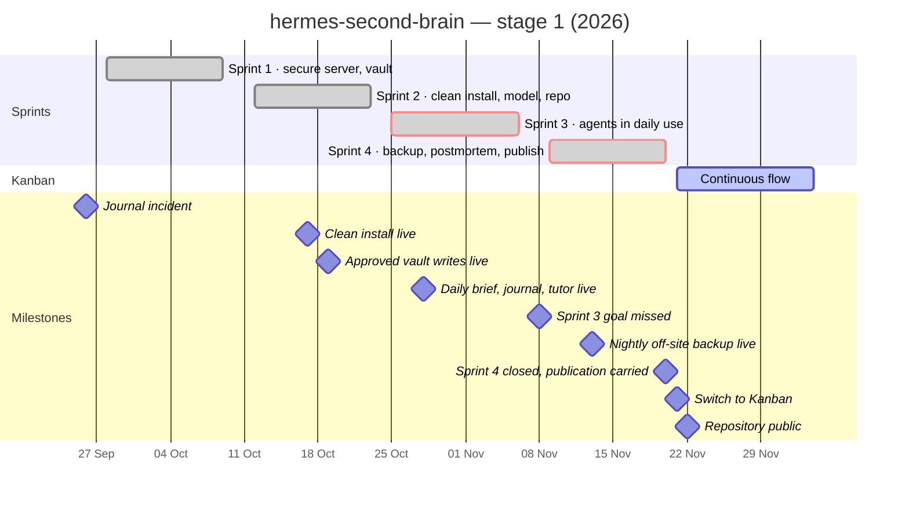

# Work log

One line per working session, oldest first, grouped by sprint. The detail behind each line lives in Jira and in the private vault; the decisions are in the [decision log](decisions.md) and the lessons in [lessons learned](lessons.md). Work was done in evening sessions, in the author's own time.

## Timeline

Sprints 3 and 4 are marked red: Sprint 3 finished all but one item and still missed its goal — see [the sprint that failed](project-management.md#the-sprint-that-failed--and-what-changed); Sprint 4 closed on time without the publication.

## Before the first sprint

| Date | Session |
|---|---|
| 26 Sep | **Journal incident** investigated; root cause found in the session database — see [POSTMORTEM.md](../POSTMORTEM.md). Routing switched to a paid endpoint, which then failed on missing credits. |
| 28 Sep | Jira site and project created; epics and the first backlog; **Sprint 1 started**. |

## Sprint 1 — secure server, knowledge base (28 Sep – 9 Oct)

| Date | Session |
|---|---|
| Sprint 1 | Port audit; SSH key login; agent panels taken off the internet and reached through an SSH tunnel; 2FA and a pinned version for n8n; Obsidian vault and templates. The audit changed the plan, so three items were added — each estimated first. |
| 11 Oct | Knowledge-base conventions (video notes, series index); Sprint 2 planning. |

## Sprint 2 — clean install, model, private repository (12 – 23 Oct)

| Date | Session |
|---|---|
| 12 Oct | **Sprint 2 started.** Old journal persona and configuration backed up; model options compared (subscription, router, other vendors) → ChatGPT Plus; 2FA and training opt-out on the account. |
| 13 Oct | Router fees, caps and privacy checked in the official documentation; account secured. **SSH hardening:** an override file was being silently beaten by a cloud-init file — fixed with a drop-in read first, verified on the effective configuration. |
| 14 Oct | **Private vault repository:** vault moved out of a cloud-synced folder (copy, verify, then retire), scanned for secrets before the first commit, private commit address, automatic sync tested. |
| 15 Oct | Planning only: Telegram topics designed; skill sources and their security model researched; fail2ban confirmed against a real attacker. |
| 17 Oct | **Clean install:** data wiped from the inside, defaults rebuilt by the container, time zone set, approval gates on, 29 toolsets reviewed one by one, model sign-in, a new bot with an allowlist. A memory entry with personal details the agent had inferred was rejected and replaced by a neutral one. |
| 17 Oct (late) | **Design session for vault access** — no server changes: the agent writes only in its own wiki folder and only with approval; the wiki-rules item moved ahead because the write test depends on it. |
| 18 Oct | **Wiki rules** written and reviewed a second time; the write mechanism chosen after three options and a second opinion — see [knowledge base](knowledge-base.md#write-mechanism--a-decision-worth-showing). |
| 19 Oct | **Vault access implemented and closed:** fine-grained token via a hidden prompt, read-only mounts, host-side script every minute, two bad batches rejected, pull-request mode tested once. A test exposed that Telegram still had a shell — closed the same day. |
| 20 Oct | First real use of the write path found a gap in the rules (a book note had nowhere to go); schema revised three times; the note approved and saved. |
| 21 Oct | **Telegram topics** with journal and health profiles cloned from the hardened default, routing written by a guarded script, isolation tested both ways. **Skills:** all 53 bundled skills found enabled; disabled by default, a few re-enabled after reading and testing. |
| 22 Oct | **Model selection closed:** real-task tests on two models, usage and model per session read from the database, cost estimate, one-month review scheduled. Profile split reviewed: it had come before the agents' requirements. |
| 23 Oct | **Sprint 2 review and retrospective;** goal met; velocity 33; five actions for Sprint 3. |

## Sprint 3 — agents in daily use (25 Oct – 6 Nov)

| Date | Session |
|---|---|
| 24 Oct | **Planning:** agents chosen, specs written question by question, backlog export analysed for conflicts; every item estimated together (four re-votes) before the sprint started. |
| 25 Oct | **Language-tutor skill:** method agreed in nine questions, saved through the approval gate, checksum verified; four skills the agent had proposed on its own reviewed and rejected; diagnostic test and flashcards confirmed on the server. **Vault skill** added mid-sprint as a recorded scope change. |
| 26 Oct | Tutor reminder and a weekly flashcard job running; the job's prompt corrected before its first run. |
| 27 Oct | **Morning brief:** weather source compared and its values checked against the raw data; instructions moved from a file into a skill after the agent rightly refused to follow a file. |
| 28 Oct | First scheduled brief reported **terminal access** — scheduled jobs had their own full toolset; trimmed in all profiles. Container time zone set. Reads between profiles found to be open; a rule added and tested. |
| 29 Oct | Journal voice notes compared (local vs. cloud transcription); moved to the backlog with both options. |
| 30 Oct | **Critical-news check** built and its criteria tightened in a second review; tutor revised after a week of use (fewer idioms, flashcards only for idioms). |
| 1 Nov | Weekend check from the session databases: silences and runs where expected; three items closed against their Definition of Done. |
| 2 Nov | Backlog ideas only; server memory measured for the voice-notes decision. |
| 3 Nov | **Backlog refinement for Sprint 4:** three items specified and estimated (weekly summary, off-site backup, voice notes); backup destinations compared. |
| 6 – 8 Nov | **Sprint 3 review in data, retrospective, sprint closed:** goal missed on one agent's daily use; two of the assistant's assumptions corrected by the data; one defect fixed during the review; *Won't Do* status introduced. |

## Sprint 4 — closing stage 1 (9 – 20 Nov)

| Date | Session |
|---|---|
| 8 Nov | **Planning:** stage 1 checked against its own scope; backlog reviewed; two missing items created; five estimated; sprint started at 33 SP. |
| 9 Nov | **Secrets inventory** by names only: an unused live key deleted, a dead token removed from an old backup, a non-existent "reserve" found in the documentation. |
| 12 Nov | **Backup set-up:** a contradiction in the spec (no-delete key vs. pruning) resolved from the tool's changelog; storage in the EU; the server's key created through the API without delete rights. |
| 13 Nov | **Backup running:** first version failed on the server (a root-only folder the local test did not have); fixed with a test reproducing the failure; restore compared by checksum; delete attempt refused by the storage API, tested on a decoy. |
| 17 Nov | Scope at risk: options set out, a Thursday checkpoint agreed. Backup status added to the brief's self-check and tested with a fake failure. **Postmortem** written from the archived database without reading journal content. |
| 18 Nov | **Publication:** README rewritten after a review from an outside reader's point of view; licences and repository name decided; a private repository created with only reviewed files. |
| 19 Nov | Checkpoint: the self-check script moved out of the sprint with a comment. Documents reviewed and committed one by one against a nine-point checklist. New models from the provider noted for the cost review. |
| 20 Nov | **Sprint 4 review, retrospective, close:** tutor checked in the learning log (7 days), backup closed after `restic stats` and a vault note; publication checked against its Definition of Done (1 of 4) and carried over; goal partly missed; three retrospective actions. |

## Kanban (from 21 Nov)

| Date | Session |
|---|---|
| 21 Nov | **Switch to Kanban:** the velocity report showed zero completed for every sprint — traced to the *Won't Do* column sitting right of *Done* and fixed; sprint reports saved as screenshots, then sprints turned off; board with WIP limits; first replenishment: publication re-estimated at 13 SP and split in two, security updates and the self-check script pulled into *To Do*. Pending agent approvals cleared: one memory entry approved, four rejected, a wiki batch approved and confirmed by the sync script. |
| 21 Nov (night) | **Security updates, system part:** security patches were already installed daily by unattended upgrades, but nothing rebooted the server, so a newer kernel was waiting. Package, container and image lists saved and a manual backup run first; 69 packages upgraded with existing config files kept; cloud-init held back on purpose; the effective SSH settings checked before the reboot; after it, every container, timer and the port list checked. A notice from the storage provider the same night — the free daily read cap exceeded — traced to restic running without its cache under systemd. |
| 22 Nov | Morning brief self-check clean after the reboot. **Restic cache fix:** `CacheDirectory` and `RESTIC_CACHE_DIR` added to the unit, a manual run filled the new cache; the next night's read count is the check. |
| 22 Nov | **Publication:** pre-publication check point by point — confidentiality in files, screenshots and the whole history, then accuracy, consistency, a "What went wrong" section, plainer README wording, links and diagrams; four fixes, each approved before it was made; old ticket numbers in early commits left in place rather than rewriting history. The author's fresh-eye review, then the switch to public: topics, a social preview, pinned first on the profile, links from the profile and the other repositories. The pre-rebuild copy kept as postmortem evidence deleted from the server. **Stage 1 closed.** |
