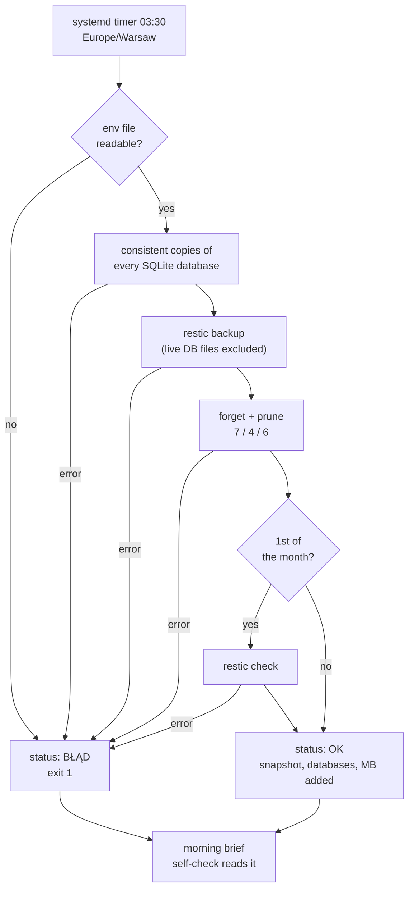

# Nightly off-site backup

A small, tested backup for a single-host agent setup: **restic → Backblaze B2 (EU)**, run by systemd every night at 03:30 Europe/Warsaw, with its result reported in the agent's morning brief.

| File | Purpose |
|---|---|
| [`hermes-backup.sh`](hermes-backup.sh) | The backup: consistent SQLite copies, `restic backup`, retention, monthly check, status line |
| [`hermes-backup.service`](hermes-backup.service) | One-shot systemd unit, low CPU and I/O priority |
| [`hermes-backup.timer`](hermes-backup.timer) | Daily at 03:30 **Europe/Warsaw** (the host runs in UTC); catches up after downtime |

Paths are set at the top of the script; the values here are neutral placeholders, not the real host layout. The published script differs from the one running on the server only in those parameterised paths and one `shellcheck` fix; the server copy is updated at its next change.

## At a glance

| | |
|---|---|
| **Recovery point objective** | ≤ 24 hours (one snapshot a night) |
| **Recovery time objective** | Not yet measured — a full restore on a fresh server has not been rehearsed (in the backlog) |
| **Size** | About 130 MB of source data; 5–45 MB added per run; 88.5 MB stored after eight nights (deduplicated and compressed) |
| **Cost** | Within the storage provider's free tier |
| **Signal on failure** | The next morning's brief, via the status line |

## What is backed up — and what is not

| Included | Excluded, and why |
|---|---|
| Agent data: profiles, skills, scheduled jobs, working data, logs | Package caches and binaries — downloadable again |
| 14 SQLite databases, as consistent copies | The live database files themselves — never copied raw |
| n8n data volume (database and its encryption key) | The vault repository clone — the vault lives in GitHub and on the author's PC |
| The vault-sync script and its state | A frozen second agent — pending a decision to remove it |
| Compose and environment files of the agent and n8n (encrypted in the backup) | The restic password itself — a backup encrypted with it would be useless without it |

## How a run works



## Design choices

| Choice | Why |
|---|---|
| **Runs on the host, not in the agent** | The agent never sees the backup password or the storage key |
| **Encrypted before it leaves the server** (restic) | The storage provider only ever holds ciphertext |
| **Storage key without the delete capability** | A compromised server cannot destroy its own backups. Since restic 0.15, a key that cannot delete makes restic *hide* files instead; a bucket lifecycle rule removes hidden files after 30 days, so pruning still frees space |
| **SQLite copied through its backup API**, never as raw files | A live database copied as a file can be inconsistent or lose recent writes. Sources are read as root; any `-wal`/`-shm` side file this creates is handed back to the database owner, so the application never loses access |
| **A persistent restic cache** (`/var/cache/restic`, created by systemd) | A system service has no home directory, so restic ran without its cache and downloaded index and tree data from the storage on every run — about 650 read transactions per night, found when the provider's free daily cap was exceeded. Fixed on 22 Nov |
| **Caches and binaries excluded** | 1.1 GB of package caches would add nothing a reinstall cannot restore; the backup is about 130 MB |
| **Retention 7 daily / 4 weekly / 6 monthly**, `restic check` on the 1st | Enough history to go back past an unnoticed problem; integrity checked regularly |
| **One status line, owned by root, read by the agent** | The morning brief's self-check reports a missing file, an error, or a backup that is not from today. The line is in Polish because the brief is |
| **Fails closed** | Any failed step writes an error status and exits non-zero; nothing is reported as OK unless every step passed |

## How it was tested

| Test | Result |
|---|---|
| `shellcheck` and `bash -n` | Clean |
| Local run on a copy of the host layout, including a parent folder readable only by root and a database written to during the copy | Passed; restored database contained the rows written during the copy; no root-owned side files left |
| First run on the server | **Failed** — database owners could not traverse a root-only folder. The fix was preceded by a local test reproducing that condition |
| Wrong repository password | Error status written, non-zero exit |
| Restore of one journal note | Identical to the original by SHA-256 |
| Delete with the server's storage key, on a **dedicated decoy file** | Refused by the storage API (`401 unauthorized`); the decoy was then hidden and left for the lifecycle rule |
| Nightly runs | Four consecutive automatic runs confirmed in the system journal before the item was closed |
| Storage reads per run | **Pending** — the next night's read transactions, checked on 23 Nov against the 650 of a run without cache |
| Status in the brief | A fake error line appeared in the brief's self-check, then the real status was restored |

Not yet done: a **full restore rehearsal on a fresh server** (in the backlog).

## Restore

```bash
. /root/.restic/env
restic snapshots                                    # list snapshots, pick an id

# a single file, compared with the original before anything is replaced
restic restore <id> --target /root/restore --include /docker/hermes-agent/data/<path>
sha256sum /docker/hermes-agent/data/<path> /root/restore/docker/hermes-agent/data/<path>

# a database: stop the writer, put the consistent copy in place, restore ownership, start again
docker compose -f /docker/hermes-agent/docker-compose.yml stop
restic restore <id> --target /root/restore --include /var/backups/hermes-sqlite
cp /root/restore/var/backups/hermes-sqlite/docker/hermes-agent/data/state.db.snapshot \
   /docker/hermes-agent/data/state.db
rm -f /docker/hermes-agent/data/state.db-wal /docker/hermes-agent/data/state.db-shm
chown 10000:10000 /docker/hermes-agent/data/state.db
docker compose -f /docker/hermes-agent/docker-compose.yml start
```

## Set-up outline

1. Create a private bucket in the EU region with a lifecycle rule that deletes hidden files after 30 days.
2. Create an application key for that bucket **through the API** with `listBuckets, listFiles, readFiles, writeFiles` only — the web console's access levels include deletion.
3. Store the repository password and the key in a password manager and in root-only files under `/root/.restic` (`700` / `600`).
4. `restic init`, install the three files, `systemctl enable --now hermes-backup.timer`.
5. Run it once by hand, restore one file, and try a delete on a decoy before trusting it.
